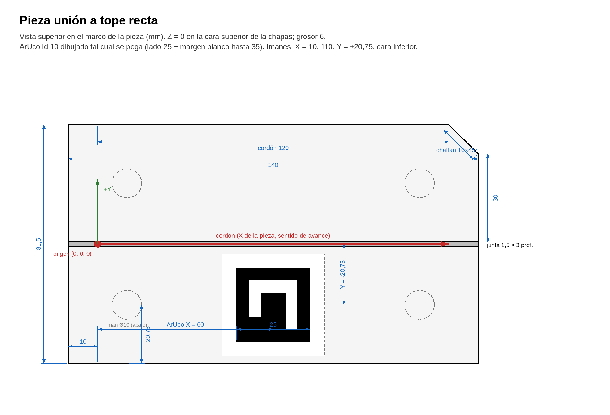
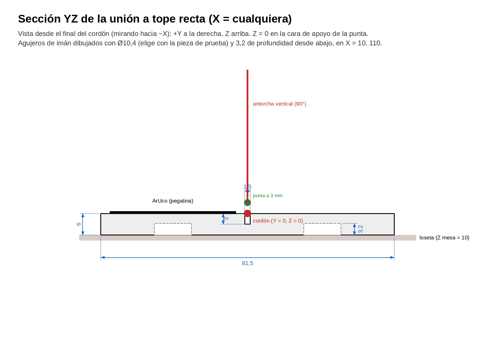
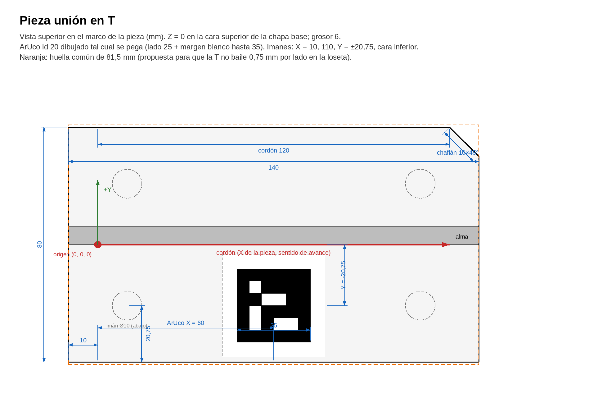
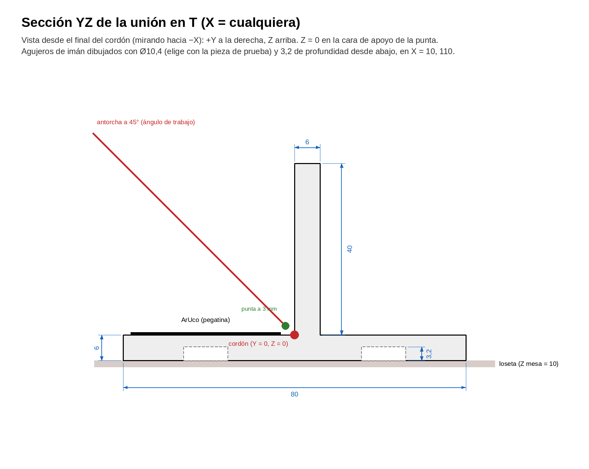
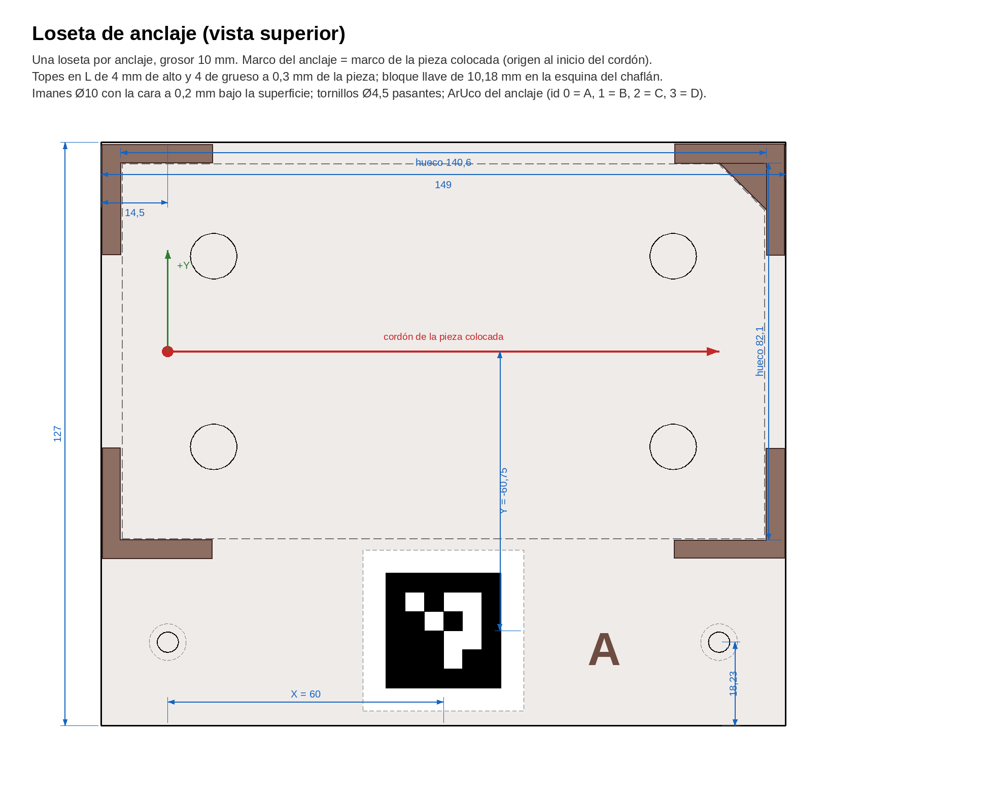
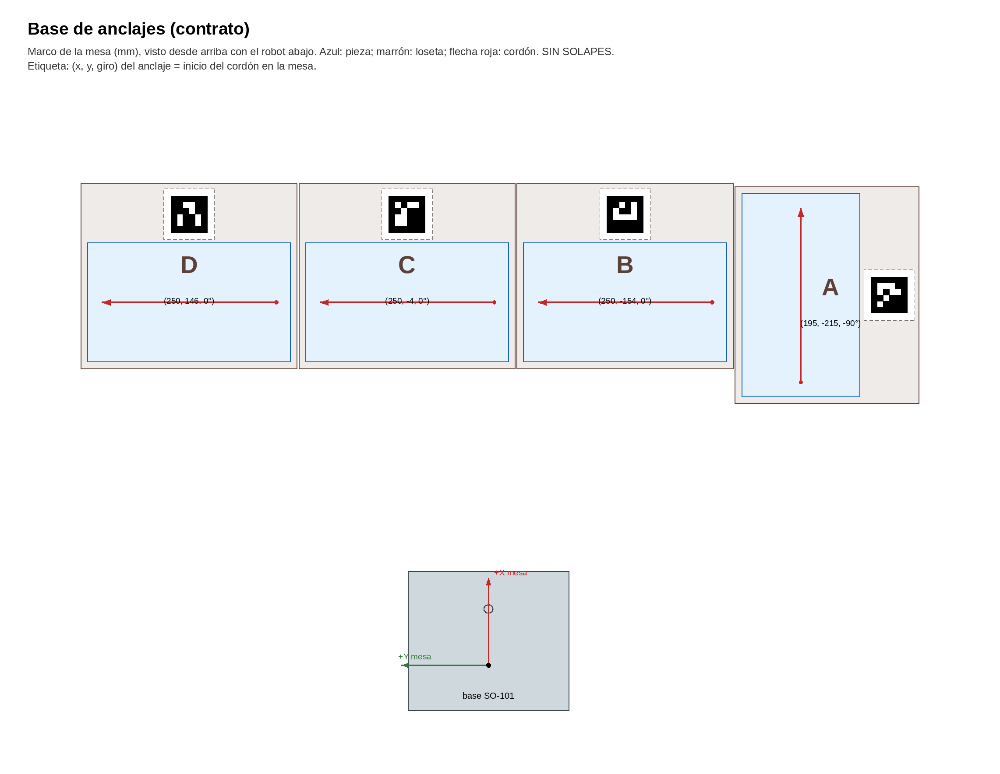
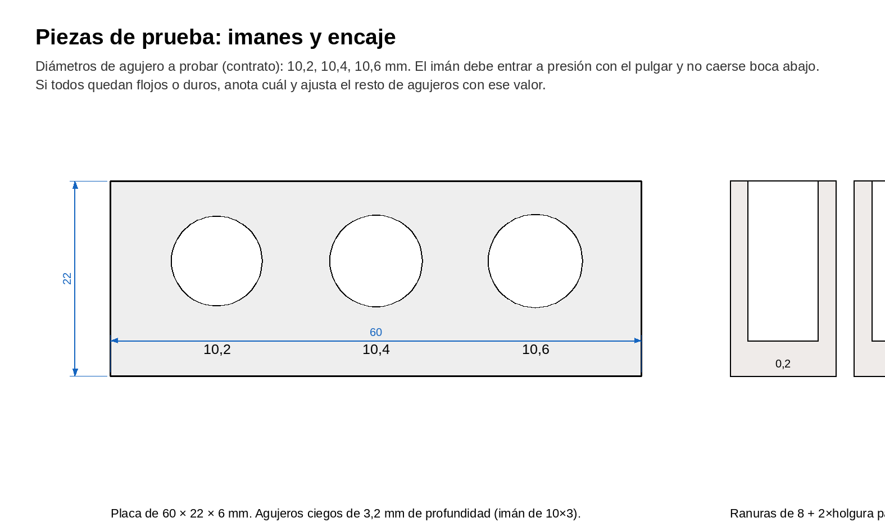
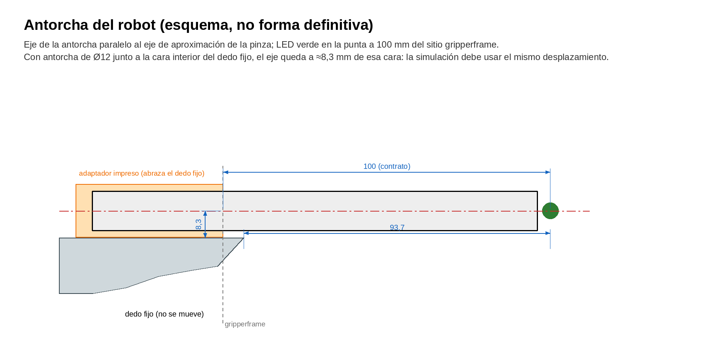
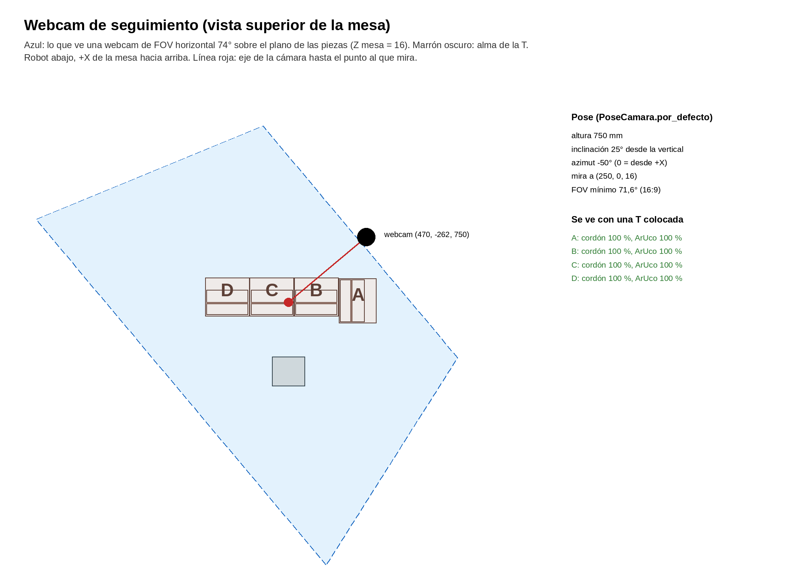

# Contrato de hardware de LeWelder

> Generado por `herramientas/generar_hardware.py` a partir de `lewelder/contrato.py`. **No lo edites a mano**: cambia el contrato y vuelve a ejecutar el script (`python herramientas/generar_hardware.py`).

Todas las medidas en **milímetros** y grados. Los planos están en [`planos/`](planos/) (PNG y SVG, a escala en el SVG).

## Avisos

1. La base de la T mide 80 mm de ancho y la recta 81,5: con una sola huella la T baila 0,75 mm por lado. **Recomendado: imprimir la base de la T a 81,5 mm** (no cambia ningún marco ni el ArUco).
2. El ArUco de la pieza está en medio del cordón, junto a la junta: la mano o la antorcha lo taparán a mitad de pasada. El software debe guardar la pose (la pieza está fija con imanes) o usar el ArUco del anclaje.
3. LED verde y ESP32: un verde de alta luminosidad cae 3,0-3,2 V y el pin da 3,3 V; con ESP32, aliméntalo a 5 V con un transistor (sección 4).
4. La IMU no debe usar el magnetómetro: los imanes de neodimio de piezas y losetas lo desvían (BNO055 en modo IMU/IMUPLUS, BNO085 con *Game Rotation Vector*).

## 0. Marcos de coordenadas

- **Mesa:** origen en el centro de la base del robot soldador sobre la mesa (= origen del cuerpo `base` del modelo MuJoCo: 31 mm por delante del borde trasero de la base, centrado en Y, y 38,8 mm por detrás del eje de giro del hombro). X hacia delante (lejos del robot), Y a la izquierda vista desde detrás del robot, Z arriba. La superficie de la mesa (o del tablero común) es Z = 0.
- **Pieza:** origen al **inicio del cordón**, X a lo largo del cordón (sentido de avance), Y a la izquierda del avance, Z arriba desde la cara superior de la chapa donde se apoya la punta. Unión a tope: el cordón es la junta (Y = 0, Z = 0). Unión en T: la esquina entre la base y el alma; el alma en Y ≥ 0.
- **Anclaje:** se toma igual que el de la pieza colocada (origen al inicio del cordón) pero sobre la cara superior de la loseta (Z mesa = 10). Z = 0 de la pieza está a Z mesa = 16.
- **Giro del anclaje:** alrededor de Z; **giro 0 → el cordón avanza en +Y de la mesa** y el +Y de la pieza apunta a −X de la mesa (hacia el robot). En general: X pieza = (−sen g, cos g), Y pieza = (−cos g, −sen g).

## 1. Piezas

Las dos piezas comparten huella, imanes y posición del ArUco, así cualquiera entra en cualquier anclaje.

### 1.1 Unión a tope recta

| Medida | Valor | Nota |
|---|---|---|
| Largo (X) | 140 | de X = -10 a X = 130 |
| Cordón | 120 | de X = 0 a X = 120, 24 tramos de 5 |
| Ancho de cada chapa | 40 | dos chapas iguales, simétricas respecto a Y = 0 |
| Junta | 1,5 de ancho | ranura de 3 de profundidad; las chapas quedan unidas por los 3 mm de abajo (una sola impresión) |
| Ancho total (Y) | 81,5 | de Y = -40,75 a 40,75 |
| Grosor | 6 | Z = 0 en la cara superior; cara inferior en Z = -6 |
| Chaflán llave | 10 × 45° | esquina (X máx., +Y): fin del cordón, lado izquierdo |

### 1.2 Unión en T

| Medida | Valor | Nota |
|---|---|---|
| Base | 140 × 80 × 6 | centrada en Y = 0 (contrato). Recomendado 81,5 de ancho para la huella común |
| Alma | 140 × 6 × 40 de alto | cara en Y = 0, ocupa 0 ≤ Y ≤ 6, apoyada sobre la base (arista viva en el cordón) |
| Cordón | 120 | esquina base-alma (Y = 0, Z = 0) |
| Antorcha | 45° de trabajo | llega desde −Y (lado del ArUco) |
| Chaflán llave | 10 × 45° | misma esquina que la recta (no toca el alma) |

### 1.3 ArUco de la pieza

| Dato | Valor |
|---|---|
| Diccionario | `DICT_4X4_50` |
| Lado (solo negro) | 25 |
| Módulo | 4,17 (lado / 6) |
| Margen blanco | ≥ 1 módulo → recorte de 35 × 35 |
| Centro en el marco de la pieza | (60, -20,75, 0) |
| Orientación | X del marcador = X de la pieza (flecha +X de la hoja en el sentido de avance), arriba del marcador hacia +Y (hacia la junta) |
| Ids recta / T | 10–19 / 20–29 (uno por pieza) |
| Holgura en la chapa | el recorte deja 2,5 mm a cada lado en Y (entre el borde exterior y la junta) |
| Rebaje en el CAD | 35,4 × 35,4 × 0,4 de profundidad, centrado en el ArUco: así la pegatina cae siempre en su sitio |

### 1.4 Imanes de la pieza (cara inferior)

4 imanes de 10 × 3 en X = 10, 110 e Y = ±20,75 (centro de cada chapa), en agujeros ciegos de 3,2 de profundidad desde abajo (quedan 2,8 mm de plástico por encima). El diámetro del agujero se elige con la pieza de prueba (sección 3). **Polaridad**: los dos imanes del inicio del cordón (X = 10) con el norte hacia abajo y los dos del final (X = 110) con el sur hacia abajo; en la loseta al revés. Así, girada 180°, la pieza se repele. Marca la cara norte de cada imán con rotulador antes de pegar (cianoacrilato).

## 2. Base de anclajes

### 2.1 Loseta de cada anclaje

Los anclajes van en fila y sus losetas quedan a ~1 mm unas de otras: la base se diseña como **una base única de ~577 × 151 × 10 mm** (la unión de las 4 losetas de la tabla 2.2) y se **imprime en 4 tramos**, uno por anclaje (cada tramo de 149 × 127 cabe en una cama de 250 mm), cortados por la línea media entre losetas contiguas. **Uniones**: cola de milano de 10 mm en cada junta (holgura 0,2 mm, lejos de topes, imanes y ArUco) más los tornillos de cada tramo al tablero común; la junta queda a ras, sin escalón. Cada tramo lleva la geometría de su loseta tal cual (abajo, en el marco de su anclaje).

| Elemento | Medida (marco del anclaje) |
|---|---|
| Loseta | X de -14,5 a 134,5, Y de -81,5 a 45,5, grosor 10 |
| Huella de la pieza | X de -10 a 130, Y de -40,75 a 40,75 (140 × 81,5) |
| Topes | 4 L en las esquinas, brazos de 20, 4 de grueso, 4 de alto, caras interiores a 0,3 de la huella (hueco 140,6 × 82,1) |
| Llave | bloque triangular de catetos 10,18 en la esquina (X máx., +Y): solo deja entrar la pieza con su chaflán en esa esquina |
| Por qué topes y no rebaje | la pieza apoya en la cara de la loseta: si se hunde en un rebaje, cambia la Z del contrato |
| Imanes | mismos X, Y que en la pieza; agujero desde arriba de 3,2, polaridad contraria |
| ArUco del anclaje | centro (60, -60,75, 0), lado 25, recorte 35, rebaje 35,4 × 0,4; id 0 = A, 1 = B, 2 = C, 3 = D; mismos ejes que el anclaje |
| Tornillos | 2 pasantes Ø4,5 en (0, -63,3), (120, -63,3), avellanados |
| Letra | letra del anclaje grabada (0,6 mm, 10 de alto) junto al tornillo derecho |

### 2.2 Posición de cada anclaje (contrato)

| Anclaje | ArUco | x | y | giro | inicio del cordón | fin del cordón | centro ArUco anclaje | dist. al eje del hombro |
|---|---|---|---|---|---|---|---|---|
| A | 0 | 195 | -215 | -90° | (195, -215) | (315, -215) | (255, -275,8) | 266–350 |
| B | 1 | 250 | -154 | 0° | (250, -154) | (250, -34) | (310,8, -94) | 214–261 |
| C | 2 | 250 | -4 | 0° | (250, -4) | (250, 116) | (310,8, 56) | 211–241 |
| D | 3 | 250 | 146 | 0° | (250, 146) | (250, 266) | (310,8, 206) | 257–340 |

| Loseta | esquinas en la mesa (x, y) | agujeros de tornillo en la mesa |
|---|---|---|
| A | (180,5, -296,5) (329,5, -296,5) (329,5, -169,5) (180,5, -169,5) | (195, -278,3) (315, -278,3) |
| B | (331,5, -168,5) (331,5, -19,5) (204,5, -19,5) (204,5, -168,5) | (313,3, -154) (313,3, -34) |
| C | (331,5, -18,5) (331,5, 130,5) (204,5, 130,5) (204,5, -18,5) | (313,3, -4) (313,3, 116) |
| D | (331,5, 131,5) (331,5, 280,5) (204,5, 280,5) (204,5, 131,5) | (313,3, 146) (313,3, 266) |

### 2.3 Comprobación de solapes

Se comprueban los polígonos reales en la mesa: pieza + recorte del ArUco del anclaje, losetas (separación mínima 0,5 mm) y base del robot (+15 mm).

**Sin solapes**: ninguna pieza (con su ArUco de anclaje) pisa a otra, las losetas quedan a ≥ 0,5 mm entre sí y ninguna invade la base del robot.

### 2.4 Fijación a la mesa y referencia al robot

1. **Tablero común** (DM o contrachapado de 10-15 mm, unos 450 (X) × 650 (Y) mm): el robot se atornilla o se embrida a él y las losetas se atornillan encima. El marco de la mesa queda unido al robot: se puede mover el conjunto sin perder la calibración. El tablero se sujeta a la mesa del evento con 2 sargentos. Su cara superior es Z = 0.
2. **Replanteo**: marca en el tablero el eje X (línea que pasa por el centro de la base del robot, hacia delante) y el origen. Con escuadra y regla, marca los agujeros de tornillo de cada loseta (tabla de 2.2) y taladra guías de 3 mm. Error admisible: ±1 mm (la cámara mide el resto con el ArUco del anclaje).
3. **Comprobación**: con la cámara de seguimiento, la posición medida de cada ArUco de anclaje debe caer a menos de 2 mm de la de la tabla. Si no, corrige la loseta o anota la medida real en el contrato.

## 3. Imanes y piezas de prueba

- Imán del contrato: **10 × 3 mm** de neodimio (N35 o mejor), 4 por pieza y 4 por loseta.
- Agujeros a probar: **10,2, 10,4, 10,6 mm**, profundidad 3,2. Elige el que entra a presión con el pulgar; si el imán gira o se cae boca abajo, demasiado flojo; si hay que martillear, demasiado duro (el PLA se raja). Pega siempre con una gota de cianoacrilato.
- Ranuras de encaje 0,2 / 0,3 / 0,4 mm por lado: elige la holgura de los topes (por defecto 0,3).
- Imprime las pruebas con la misma impresora, filamento y perfil que las piezas: la holgura depende de ellos.

## 4. Antorcha del alumno (requisitos, la forma es libre)

| Requisito | Detalle |
|---|---|
| LED en la punta | LED verde de 5 mm de alta luminosidad, centrado en el eje de la boquilla y asomando 2-3 mm: es el punto que sigue la cámara. Lijado o difuso para que se vea de lado (la cámara no lo ve de frente). Nada brillante cerca de la punta |
| Eje de la antorcha | del mango a la punta. Si la boquilla tiene cuello curvo, el eje es el del **tramo final** (boquilla) |
| IMU | montada rígida y plana, con **+X paralelo al eje de la boquilla, hacia la punta** (contrato: (1.0, 0.0, 0.0)). Lejos (> 3 cm) de imanes y del cable del LED. Sin magnetómetro en la fusión |
| Gatillo | pulsador o microinterruptor de palanca bajo el índice, a GND con `INPUT_PULLUP`; recorrido corto y tope mecánico |
| Microcontrolador | hueco para Arduino Nano (≈ 45 × 18 mm, + 2 mm de holgura) **o** ESP32 DevKit (≈ 55 × 28 mm); mide tu placa. Conector USB accesible para programar sin desmontar |
| Cable | USB de 3 m saliendo por detrás del mango, con **alivio de tensión**: brida o abrazadera interior que muerda la funda + manguito flexible a la salida. El conector de la placa no debe soportar tirones |
| Cableado interno | canal de Ø 4 mm del mango a la punta para 2 hilos del LED; IMU con 4 hilos (VCC, GND, SDA, SCL) cortos |
| Montaje | dos mitades atornilladas (M3 + insertos térmicos) para poder abrir; impresas sobre la cara de corte |
| Peso y tamaño | parecido a una antorcha MIG pequeña: 180-250 mm, mango de Ø 30-35 mm, < 250 g |
| Reposo / calibración (opcional) | cuna en una esquina del tablero que sujete la antorcha en una posición conocida (por ejemplo vertical): sirve de soporte y para poner a cero la IMU |

Pines y protocolo (del contrato):

| Placa | Gatillo | LED | SDA | SCL |
|---|---|---|---|---|
| nano | 2 | 9 | A4 | A5 |
| esp32 | 4 | 2 | 21 | 22 |

Serie a 115200 baudios, 100 Hz, una línea JSON por muestra `{"t": ms, "g": 0|1, "q": [w, x, y, z]}`; responde a `?` con `{"id": "alumno"}`.

**LED y resistencia**: con Nano (5 V): LED verde (≈ 3,1 V a 15-20 mA) + resistencia de **100-150 Ω** directamente del pin. Con ESP32 (3,3 V) el verde casi no luce: usa un transistor NPN (BC547/2N2222, base con 1 kΩ) o un MOSFET lógico que conmute el LED desde 5 V (pin VIN/5V) con 100-150 Ω.

## 5. Antorcha del robot

| Requisito | Detalle |
|---|---|
| Longitud | **100 mm** desde el sitio `gripperframe` del modelo hasta el centro del LED, a lo largo del eje de aproximación de la pinza. En el robot real `gripperframe` está 6,3 mm por detrás del extremo del dedo fijo → el LED queda a **93,7 mm del extremo del dedo fijo** |
| LED | verde, igual que el del alumno, centrado en el eje y asomando 2-3 mm; responde a `L1`/`L0` y a `?` con `{"id": "robot"}` |
| Sujeción | adaptador impreso que abraza el **dedo fijo** (no se mueve con la pinza) con 2 bridas o un tornillo M3 pasante. No dependas de que la pinza apriete: deja la pinza en una posición fija abierta para que el motor no trabaje en bloqueo |
| Que no gire | caras planas del adaptador contra las caras del dedo + antorcha con un plano o chaveta en el adaptador. Con el robot quieto, empuja la punta con el dedo: no debe moverse más de 0,5 mm |
| Rigidez | lo más corta y gruesa posible (Ø 12-16 mm), impresa tumbada (capas a lo largo) o con un tubo de aluminio/carbono dentro |
| Cable | 2 hilos del LED hasta un Nano en la muñeca o en la base; USB de 3 m con holgura para todo el recorrido del brazo (incluido el giro de muñeca), sujeto con espiral al brazo |
| Simulación | la tarea de simulación debe poner la punta a la misma distancia y con el mismo desplazamiento lateral (radio de la antorcha si va pegada a la cara interior del dedo) |

Medidas aproximadas de los dedos sacadas del modelo (`assets/so101`; **compruébalas con el calibre** en el robot real). a = distancia hacia atrás desde el extremo del dedo; ancho = perpendicular al cierre; grosor = en la dirección de cierre.

| a (mm) | ancho dedo fijo | grosor dedo fijo | ancho dedo móvil | grosor dedo móvil |
|---|---|---|---|---|
| 8 | 12,2 | 8,7 | 12,4 | 10,6 |
| 16 | 14 | 10 | 14,2 | 12,2 |
| 26 | 15,5 | 11,9 | 15,6 | 12,8 |
| 36 | 17,1 | 15,3 | 16,9 | 14 |
| 46 | 19,2 | 17 | 19,1 | 14,9 |

Las caras interiores de los dedos no son paralelas (el dedo móvil gira): una antorcha redonda apretada entre ellos se va de lado; por eso el adaptador va al dedo fijo.

## 6. Soportes de cámara

### 6.1 Cámara de muñeca (política)

- En el cuerpo de la pinza (gira con la muñeca), mirando a la punta de la antorcha. Parte del soporte de cámara de muñeca del SO-101 de LeRobot y añádele la inclinación.
- Si la cámara queda a 30 mm por detrás de `gripperframe` y a 40-50 mm del eje de la antorcha, inclínala ≈ 19° hacia el eje: la punta queda en el tercio inferior de la imagen y se ve el cordón por delante.
- No debe sobresalir por debajo de la punta ni chocar con el alma de la T con la antorcha a 45° (compruébalo en la simulación); cable USB sujeto al brazo con holgura en la muñeca.

### 6.2 Webcam de seguimiento

La pose de la webcam es la de todo el software: `PoseCamara.por_defecto()` de `lewelder/camara_sintetica.py`: **750 mm de altura, inclinada 25° respecto a la vertical, azimut -50°** (0 = desde +X, enfrente del robot; negativo hacia −Y, el lado del anclaje A), mirando a (250, 0, 16). Centro óptico en (470, -262, 750) del marco de la mesa. Desde +X el alma de la T del anclaje A (girado −90°) taparía la punta; desde este lado no.

Para ver todas las losetas y la altura del alma con un 5 % de margen hace falta un **FOV horizontal ≥ 71,6°** (16:9). Webcams típicas en 1080p:

| FOV horizontal | FOV vertical | ¿ve toda la base? | mm por píxel en las piezas |
|---|---|---|---|
| 65° | 39,4° | no | 0,46–0,61 |
| 70° | 43° | no | 0,5–0,67 |
| 74° | 45,9° | sí | 0,54–0,72 |
| 78° | 49° | sí | 0,58–0,77 |

**Recomendado**: FOV ≈ 74° o más, en la pose de arriba. El alumno se coloca a un lado, no entre la cámara y la base. Exposición manual fija y baja.

Con una T colocada en cada anclaje y esta cámara (FOV recomendado), se ve: A: cordón 100 %, esquinas de ArUco 100 %, B: cordón 100 %, esquinas de ArUco 100 %, C: cordón 100 %, esquinas de ArUco 100 %, D: cordón 100 %, esquinas de ArUco 100 %. (Cordón: la punta a 3 mm con la antorcha a 45°, sin que el alma se interponga.)

Soporte: rosca de 1/4" de la webcam en un trípode o brazo articulado, o una pinza impresa a un tubo de Ø 20 mm; debe poder bloquearse (si la cámara se mueve hay que recalibrar). Calibra la cámara con el tablero de `aruco/tablero_calibracion_a4.pdf`.

## 7. Tolerancias e impresión (PLA)

| Tema | Recomendación |
|---|---|
| Capa / paredes / relleno | 0,2 mm; 3-4 perímetros; 20-30 % giroide (losetas 30 %: pesan y no se mueven) |
| Pata de elefante | compensación 0,15 mm o chaflán de 0,5 mm en las aristas de la cara de abajo: si no, la huella crece y no entra entre los topes |
| Agujeros | salen 0,1-0,3 mm más pequeños: por eso la pieza de prueba de imanes |
| Holguras de encaje | deslizante 0,2-0,3 mm por lado (topes: 0,3); a presión 0,05-0,1 mm |
| Contracción | PLA ≈ 0,2-0,3 %: en 140 mm, hasta −0,4 mm. Mide la primera pieza y corrige la escala XY del laminador si se pasa de ±0,3 |
| Orientación | piezas y losetas planas, cara inferior en la cama (los agujeros de imán de la pieza quedan abajo y salen bien sin soportes); antorchas en dos mitades sobre la cara de corte; antorcha del robot tumbada |
| Color | PLA mate gris oscuro o negro para piezas y losetas: más contraste con el LED y sin reflejos; los ArUco llevan su margen blanco en la pegatina |
| Pegatinas | papel adhesivo mate, impresora láser si puede ser; nada de plastificar (brilla) |

## 8. Lista de verificación con calibre (±0,3 mm salvo que se diga)

- [ ] Hoja de marcadores: la regla mide 50,0 mm (±0,3). Si no, se imprimió escalada: repetir al 100 %
- [ ] Lado negro de un ArUco impreso: 25 (±0,2)
- [ ] Recta: largo 140, ancho 81,5, grosor 6, junta 1,5 (±0,2)
- [ ] T: base 140 × 80, alma 6 de grueso y 40 sobre la base (total 46); del borde −Y de la base a la cara del alma 40
- [ ] Chaflán llave de 10 en la esquina correcta (fin del cordón, lado +Y)
- [ ] Centro del ArUco pegado: a 60 del inicio del cordón (o 70 del borde) y a 20,75 de la junta
- [ ] Imanes: entran con el agujero elegido, quedan 0,1-0,3 mm por debajo de la cara y con la polaridad marcada
- [ ] Loseta: grosor 10, hueco entre topes 140,6 × 82,1; la pieza entra sin forzar, no baila más de 0,3 y no entra girada 180°
- [ ] Altura de la cara de la pieza colocada sobre el tablero: 16
- [ ] Losetas en el tablero: tornillos a ±1 mm de la tabla de 2.2
- [ ] Antorcha del robot: LED a 93,7 del extremo del dedo fijo; no gira ni cede al empujarla
- [ ] Antorcha del alumno: la IMU marca +X hacia la punta (inclina la antorcha hacia abajo y mira el signo)

## 9. Marcadores ArUco y tablero de calibración

- [`aruco/marcadores_a4.pdf`](aruco/marcadores_a4.pdf): página 1, piezas (ids 10-29: los de recta y T, con repuestos); página 2, anclajes (0-3, dos de cada). Vectorial, A4, imprimir al 100 %.
- [`aruco/tablero_calibracion_a4.pdf`](aruco/tablero_calibracion_a4.pdf): tablero de 9 × 6 esquinas interiores, cuadro de 25 mm (A4 apaisado).
- `aruco/aruco_XX_*.png`: cada marcador suelto a 600 ppp con su margen blanco; `aruco/hoja_*.png`: las páginas en PNG.

Verificación automática (OpenCV vuelve a leer lo generado):

- `hoja_piezas.png` (600 ppp): 20 ids detectados de 20 esperados, lado 24,96–25 mm (contrato 25) → OK
- `hoja_anclajes.png` (600 ppp): 4 ids detectados de 4 esperados, lado 24,96–25 mm (contrato 25) → OK
- PNG sueltos (24): todos con su id y lado correctos
- `marcadores_a4.pdf` rasterizado a 600 ppp con pdftoppm: 2 páginas, 24 ids, lado 24,96–25 mm → OK
- Tablero: 9×6 esquinas detectadas, cuadro de 24,98 mm (25) → OK
- `tablero_calibracion_a4.pdf` rasterizado: cuadro de 24,98 mm → OK
