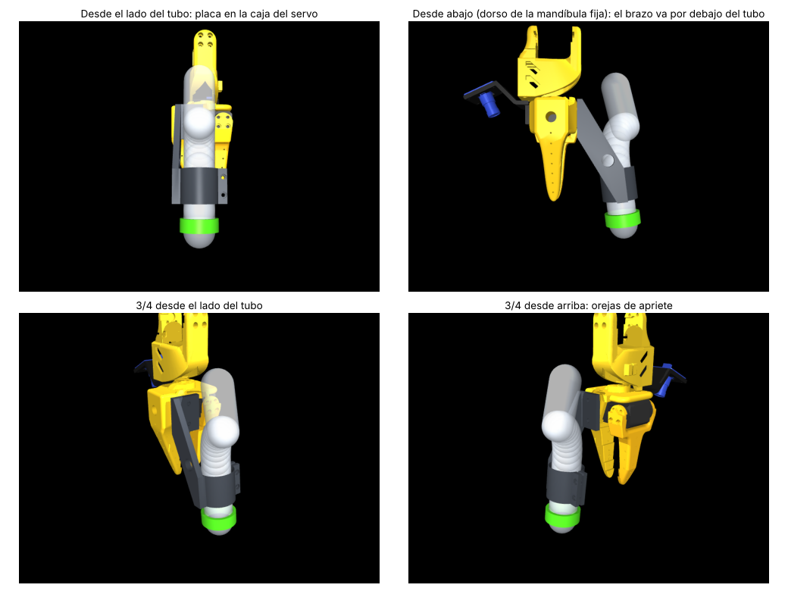
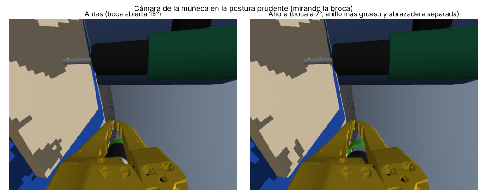
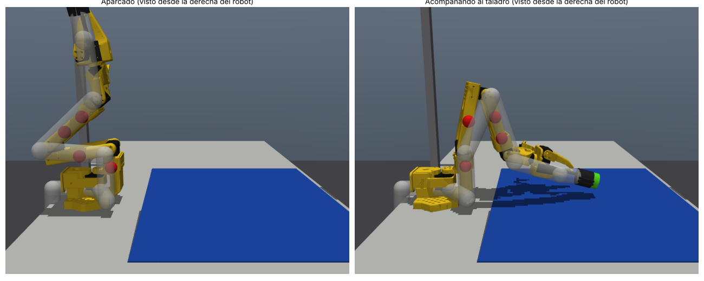

# Garbi · amarre de la boca del tubo y bridas por el brazo (20-11, revisado el 21-11)

Piezas para el **montaje lateral** de `garbi/escena.py`:
- la boca del tubo va en la mandíbula fija, por el lado contrario a la cámara;
- la cámara oficial de la muñeca ve la punta del tubo y la broca.

La geometría es la de la simulación:
- centro de la boca en (-5, -70, -128) mm, en el marco de la pinza;
- boca abierta **7°** hacia fuera (antes 15°; ver «Visibilidad»).

Así lo que se probó en la simulación vale para la pieza real.

| Archivo | Qué es |
|---|---|
| `amarre_boca.py` | CAD paramétrico (CadQuery). Genera STEP (para SolidWorks) y STL de las tres piezas |
| `amarre_boca/amarre_boca.*` | Placa + brazo + abrazadera partida (≈ 32 g en PLA macizo) |
| `amarre_boca/anillo_boca.*` | Anillo verde lima de la punta. Es la marca que usa la cámara de arriba para calibrar. Pared de 3 mm, Ø exterior 35,4 (≈ 5 g) |
| `amarre_boca/silla_brida.*` | Asiento para atar el tubo al costado de un eslabón. Hacen falta 4 (≈ 5 g cada uno) |
| `comprobar_amarre.py` | Comprueba choques con la pinza (mallas oficiales del SO-101) |
| `amarre_boca/vistas_pieza.png`, `vista_camara.png`, `recorrido_bridas.png` | Vistas |



## 1. Antes de imprimir: mide el tubo

No se pudo leer la ficha de Leroy Merlin, que bloquea las consultas automáticas. Las mangueras extensibles de
desagüe de lavadora suelen medir **unos 29 mm de diámetro exterior en las crestas** y 20-21 mm por dentro. Ese es el
valor por defecto.

**Mide con calibre el diámetro exterior** en el tramo que irá en la abrazadera. Es el tramo de 25 a 57 mm desde la
boca. Después regenera las piezas:

```bash
python hardware/garbi/amarre_boca.py --tubo 28.4
```

Las tres piezas se ajustan solas:
- la abrazadera tiene 0,6 mm de holgura y se cierra con los M3;
- el anillo tiene 0,4 mm;
- la silla tiene 0,6 mm.

**Qué extremo usar como boca:**
- corta el gancho preformado;
- deja una boca recta y limpia en un tramo corrugado, o usa el manguito liso si mide lo mismo.

El otro extremo va a la aspiradora con un adaptador (pendiente).

## 2. Amarre a la mandíbula fija

Se mide en el STL oficial de la pinza (`wrist_roll_follower_so101_v1`).

**Dónde apoya:** la cara -y de la caja del servo de la pinza (y = -24), la contraria al soporte de la cámara. La zona
plana va de x -16 a -2 y de z -6 a -32.

**Cómo se sujeta:** con los **dos tornillos M2 que fijan el servo por ese lado**, en (x -13, z -13,2) y
(x -13, z -33,7):
- se quitan;
- se ponen otros **5 mm más largos** (la placa mide 5 mm), con la cabeza en el cajeado de la placa.

No hay que taladrar el robot.

**Holguras** (`comprobar_amarre.py`):

| Elemento | Holgura |
|---|---|
| Mordaza móvil, en todo su recorrido (-10° a 100°) | ≥ 8,9 mm. La mordaza nunca sale de \|y\| ≤ 24,1 y todo el amarre está en y < -24 |
| Servo de la pinza | 6,4 mm |
| Muñeca | ≥ 15 mm |
| Cámara | 80 mm |
| Tubo saliendo de la abrazadera, recto hacia atrás o curvado hacia fuera | 2,9 mm |

El único contacto es la cara de apoyo.

**Por dónde va el brazo de la pieza:**
- va **por debajo del tubo**, por el lado del dorso de la mandíbula fija, y se une a la abrazadera por abajo;
- así el tubo no lo cruza al salir hacia atrás (en la versión del 20-11 el brazo estaba en el plano del tubo y chocaba).

**Cómo sale el tubo:** puede salir **recto hacia atrás** o curvarse algo hacia fuera. La salida de la abrazadera está abocinada para que el tubo no se clave en el borde.

**La abrazadera:**
- es partida;
- coge el tubo del mm 25 al 57 detrás de la boca, separada del anillo para que no lo tape;
- se aprieta con **2 tornillos M3 × 16 con tuerca** (la tuerca va en su alojamiento hexagonal);
- las orejas de apriete van arriba de la abrazadera, fuera del camino del tubo.

Delante de la abrazadera, el **anillo verde** se mete en los 12 mm de la punta. Con un punto de pegamento basta. Si
no imprimes en verde lima, sirve cinta de ese color.

**Visibilidad** (estudio en la simulación con la pieza real, 21-11):
- la cámara está al otro lado de las mordazas y ve la punta del tubo **por el hueco entre ellas**; lo que más la tapa
  es el dedo fijo;
- sacar la boca más allá de la punta empeora (a 17 y 32 mm más adelante se ve un 30-70 % menos): se mete detrás de
  las mordazas;
- bajarla hacia el dorso de la mandíbula también empeora: la tapa el dedo fijo;
- lo que ayuda: boca menos abierta, anillo más grueso y abrazadera separada del anillo;
- elegido: **boca a 7°, anillo de pared 3 y abrazadera a 25 mm de la boca**. El anillo se ve **2,4 veces más** que
  con el primer diseño (867 frente a 357 píxeles a 640 × 480);
- la boca recta (0°) se ve algo más (982 px), pero en la simulación el brazo pasa a 4,2 mm de la mano que se cruza
  (mínimo 10). Un anillo de pared 5 se ve más, pero la calibración con el anillo pasa de 2 mm de error;
- con 7° el ciclo cumple todo en la simulación, subiendo `BORDE_LIMPIEZA` de 6 a 7,5 mm (`garbi/ciclo.py`): en la
  pasada final el borde de la boca bajaba a 2,4 mm de la madera;
- la punta de la broca se ve en la postura prudente en todos los casos probados, igual que sin la pieza;
- abrir la mordaza móvil no cambia nada: no es ella la que tapa.



### Material

| Cantidad | Pieza |
|---|---|
| 2 | Tornillos M2 de los originales del servo + 5 mm (mira el largo del que quitas) |
| 2 | Tornillos M3 × 16 |
| 2 | Tuercas M3 |
| 8 | Bridas de 4,8 × 300 mm (rodean eslabón + tubo) |

### Impresión

- PLA o PETG, 0,2 mm, 4 perímetros y 40 % de relleno.
- **Amarre:** tumbado sobre la cara de abajo del brazo (la que mira al dorso de la mandíbula). Con soportes bajo la abrazadera.
- **Anillo y sillas:** de pie, sin soportes.

## 3. Bridas a lo largo del brazo

El tubo va por el **costado derecho del brazo** (-y, el lado contrario a la cámara), pegado a los eslabones. Pasa por
la prolongación del eje de cada articulación. Por eso **no se estira ni se retuerce** al moverse, y la muñeca no
gira (`wrist_roll` = 0).

La regla es atar el tubo a los eslabones, nunca a los servos ni a los cuernos, y dejar libre el tramo que cruza cada
eje.

Secciones medidas en las mallas oficiales:
- brazo: 64 × 24 mm;
- antebrazo: 60 × 24 mm.

Una brida de 300 mm rodea eslabón + silla + tubo.



Coordenadas en mm, con el robot en la postura cero; en rojo en la imagen:

| Punto | Dónde | Cómo |
|---|---|---|
| A | Amarre de la pinza: la abrazadera | El tubo sale de la abrazadera hacia atrás |
| S1 | Antebrazo, a **45 mm antes del eje de la muñeca** (x ≈ 187) | Silla + 2 bridas de 300 |
| S2 | Antebrazo, a **45 mm después del eje del codo** (x ≈ 142) | Silla + 2 bridas de 300 |
| S3 | Brazo, **en el centro** (z ≈ 173, entre el hombro y el codo) | Silla + 2 bridas de 300 |
| S4 | Soporte del hombro (gira con la base), bajo el eje del hombro (z ≈ 82) | Silla + 2 bridas. De aquí el tubo baja y sale por detrás de la base |

Entre cada par de puntos queda un **tramo libre que cruza el eje**:

| Tramo | Largo libre |
|---|---|
| A → S1 (muñeca) | ~160 mm |
| S2 → S3 (codo) | ~100 mm |
| S3 → S4 (hombro) | ~90 mm |

**Detrás de la base:**
- el tubo **no debe colgar del robot**;
- átalo a la pértiga o a una pinza en el borde de atrás de la mesa, con un bucle flojo que deje girar la base (±60°).

Así el robot solo carga el medio metro del brazo. Es el riesgo del par del hombro de `viabilidad-tecnica.md`.

**Montaje:**
1. Pon las bridas sueltas.
2. Mueve el brazo a mano (servos sin par) de **aparcado** a la **postura más estirada** de limpiar.
3. Comprueba que el tubo no tira de ningún tramo ni toca la mesa.
4. Aprieta las bridas.

## Pendiente

- Medir el tubo y regenerar las piezas.
- Comprobar el largo de los M2 del servo de la pinza.
- Pesar el conjunto (amarre + anillo + tubo del brazo): objetivo ≤ 100 g en la punta.
- Si el brazo de 6 mm vibra, subir `BRAZO_GROSOR` a 8.
- En la simulación, el tubo se dibuja con Ø32 (`TUBO_DIAMETRO`). Si el real mide otra cosa, actualizar `garbi/escena.py`.
