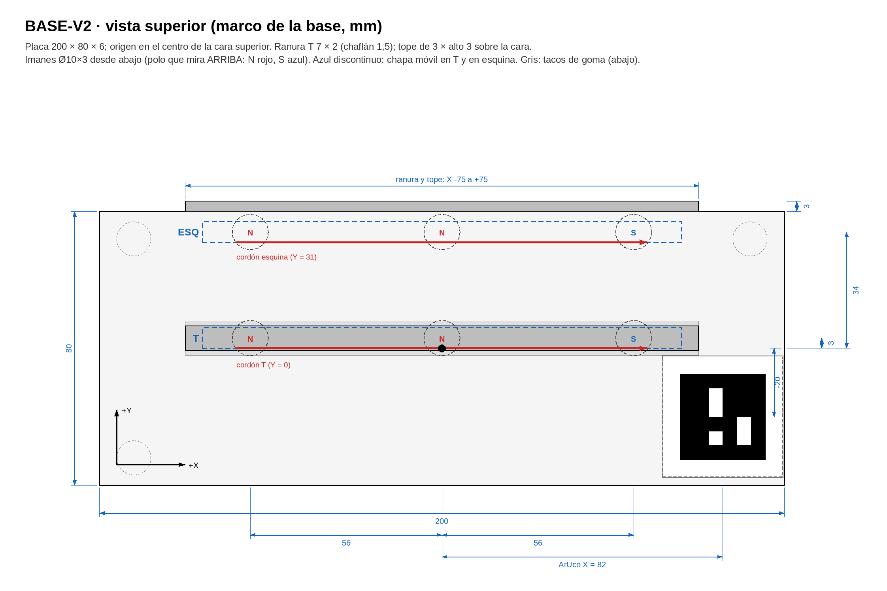
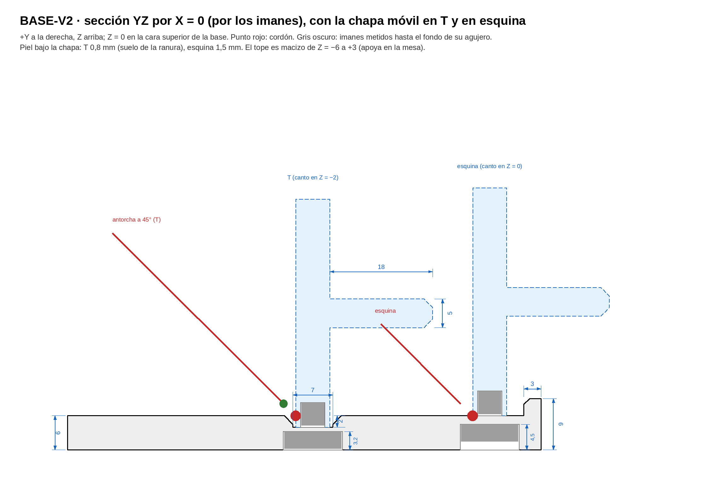
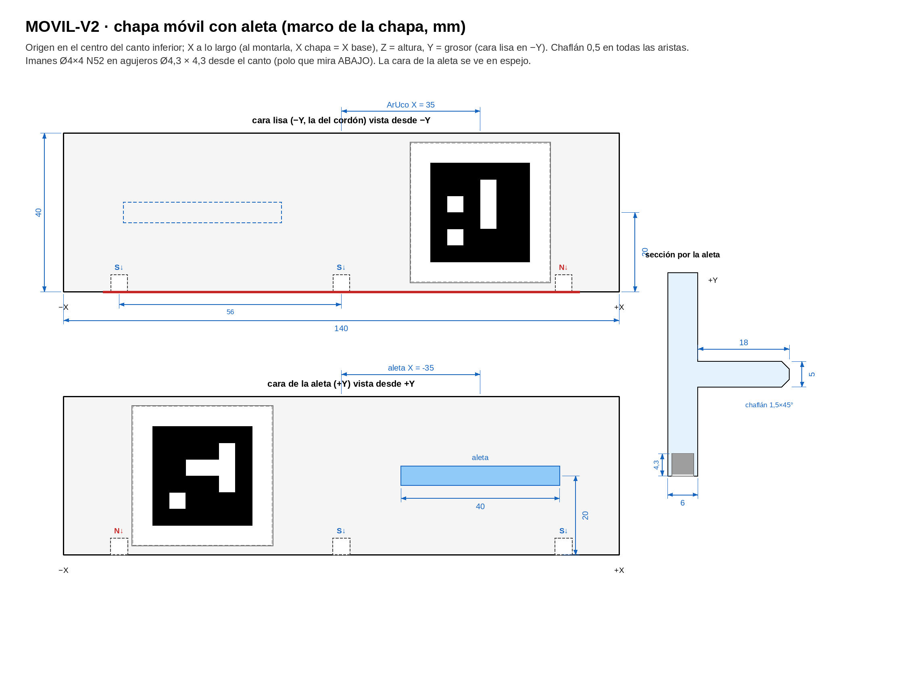
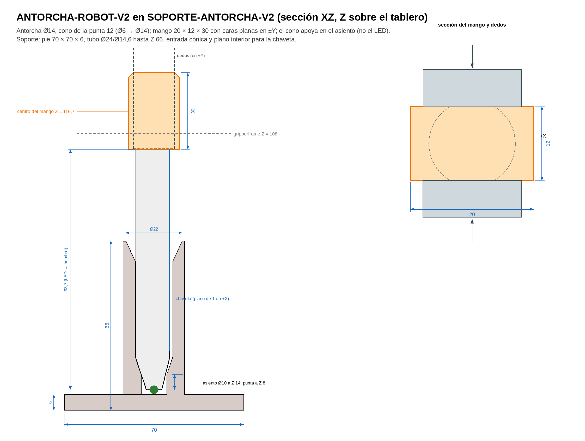
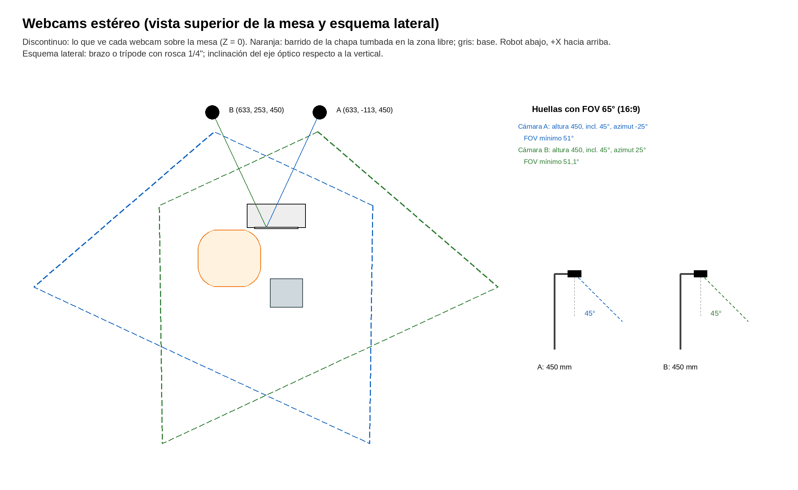
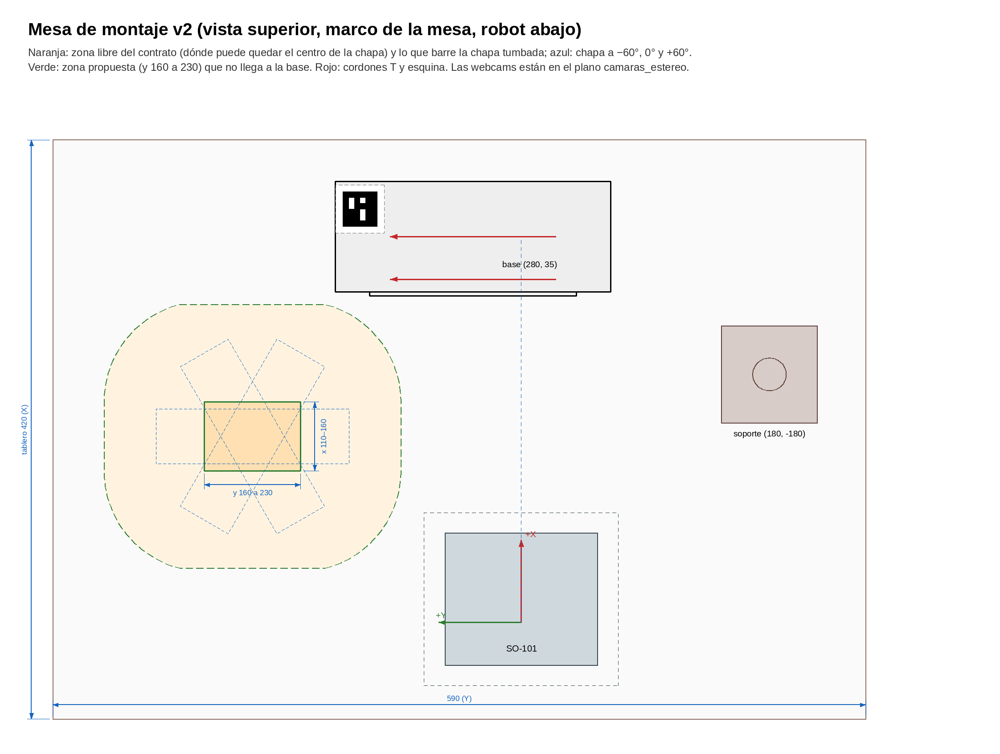
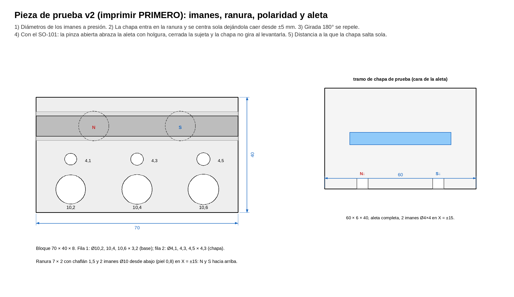

# Contrato de hardware de LeWelder v2

> Generado por `herramientas/generar_hardware_v2.py` (`python herramientas/generar_hardware.py --v2`) a partir de `lewelder/contrato.py` y de las decisiones del brief. **No lo edites a mano.**
>
> **El documento para modelar en SolidWorks es [`brief_solidworks.md`](brief_solidworks.md)**: este contrato lo comprueba (medidas, choques, imanes, cámaras), justifica el diseño y da los planos acotados y la lista de comprobación.

Medidas en **mm** y grados. Planos en [`planos/`](planos/) (PNG y SVG a escala). Marcadores en [`aruco/`](aruco/). Lista de material en [`lista_material.md`](lista_material.md).

## Avisos (incoherencias y propuestas)

1. **Imanes de la chapa móvil Ø4 × 4** (no Ø10 × 3): un Ø10 no cabe en el canto de una chapa de 6. Propuesta: añadir `IMAN_MOVIL = (4, 4)` al contrato.
2. **Polaridad corregida en el brief**: con todos los imanes iguales (N arriba en la base, S abajo en la chapa) la chapa girada 180° (aleta hacia el cordón) también se pega. Ahora la base lleva N/N/S hacia arriba y la chapa S/S/N hacia abajo (X = -56, 0, 56): girada 180° se repele (sección 4).
3. **Tope de la esquina corregido en el brief**: un nervio de Y +40 a +43 solo de Z 0 a +3 queda fuera de la placa (flotando) y los agujeros de los imanes de la esquina (Ø10,4 en Y = 34, hasta Y = 39,2) saldrían por el canto. El tope es macizo de Z = −6 (mesa) a +3: la base mide 83 de ancho en el tramo del tope.
4. **Altura de la chapa en T y en esquina**: en la T el canto entra 2 mm en la ranura (canto en Z = −2); en la esquina apoya en la cara (Z = 0). El software (tarea 1) y la simulación (tarea 2) deben usar esta diferencia: centro del ArUco 41 a Z = 18 (T) o 20 (esquina) sobre la cara de la base. Propuesta: `Z_CANTO_MOVIL = {T: −2, esquina: 0}` en el contrato.
5. **Imanes en X = -56, 0, 56** (el brief decía -50, 0, 50): en la chapa, el agujero del imán de +50 queda bajo el hueco de la pegatina ArUco (X 17,3 a 52,7) con 0,55 mm de pared; a ±56 la pared es de 1,27 mm. Cambia en la base y en la chapa a la vez (deben quedar enfrentados). Corregido en el brief.
6. **Antorcha del robot**: el cuerpo pasa de 95 a **93,7** (= 100 − 6,3): las puntas de los dedos apoyan en el hombro del mango (Ø14 > 12) y así `gripperframe` queda a 100 de la punta, como dice el contrato. La chaveta empieza en Z = 15 para que encaje dentro del tubo del soporte (de Z 60 a 95 quedaba por encima del tubo). Corregido en el brief.

## 1. Marcos y convenios

- **Mesa**: el de la v1 (origen en el centro de la base del robot, X hacia delante, Y a la izquierda, Z arriba; Z = 0 en el tablero).
- **Base**: origen en el centro de la cara superior; X a lo largo (200), Y transversal, Z arriba. En la mesa, su centro en (280, 35) con giro 0: **X base → +Y mesa, +Y base → −X mesa (hacia el robot)**. La cara superior está a Z mesa = 6.
- **Chapa móvil**: origen en el centro del canto inferior (el que apoya), X a lo largo, Z = altura de pie, Y = grosor; cara lisa en −Y (cordón, la ven las webcams), cara de la aleta en +Y (la ve el robot). Montada, sus ejes son paralelos a los de la base.
- **Cordón**: T → X −60…+60 en Y = 0, Z = 0; esquina → mismo X en Y = 31, Z = 0 (marco de la base).

Orientación de cada ArUco (para la tarea 1):

| id | dónde | centro | +X del marcador | arriba del marcador | normal (sale de la cara) |
|---|---|---|---|---|---|
| 30 | cara superior de la base | (82, -20, 0) base | +X base | +Y base | +Z base |
| 41 | cara lisa (−Y) de la móvil | X 35, Z 20 (chapa) | +X chapa | +Z chapa | −Y chapa |
| 40 | cara de la aleta (+Y) | X 35, Z 20 (chapa) | **−X chapa** | +Z chapa | +Y chapa |
| 42, 43, 44, 45 | repuestos | igual que 40 (pares) y 41 (impares) |  |  |  |

En las dos caras el marcador se pega **leyendo derecho al mirar la cara, con el canto que apoya abajo**; por eso el +X del 40 va hacia −X de la chapa. Tumbada (cara lisa abajo, aleta arriba) se ve el 40; montada, las webcams ven el 41.

## 2. Base fija (BASE-V2)

| Elemento | Medida | Por qué |
|---|---|---|
| Placa | 200 × 80 × 6, chaflán 0,5 abajo | contrato; el chaflán evita la pata de elefante |
| Ranura de la T | X -75 a 75, Y/Z -0,5 a 6,5; ancho 7, prof. 2, chaflán 1,5 × 45° en las dos aristas | chapa de 6 con 0,5 de holgura por lado; captura geométrica ±2,5 (holgura + chaflán de la ranura + chaflán de la chapa); los imanes hacen el resto hasta ±5 |
| Tope de la esquina | nervio X -75 a 75, Y +40 a +43, **macizo de Z −6 a +3**, chaflán 1 × 45° arriba por dentro | para la chapa por fuera (un error hacia +Y no la tira de la base); el chaflán la guía; la cara exterior de la chapa queda enrasada con el canto |
| Imanes | Ø10 × 3 N52, agujeros Ø10,4 desde abajo en X = -56, 0, 56; línea T en Y = 3 (prof. 3,2), esquina en Y = 34 (prof. 4,5) | coaxiales con los de la chapa colocada; piel 0,8 (T) y 1,5 (esquina): la chapa apoya en plástico, no en imán |
| Polaridad (cara de arriba) | X -56: N / X 0: N / X 56: S | asimétrica: la chapa girada 180° se repele (sección 4) |
| Hueco del ArUco 30 | 35,4 × 35,4 × 0,3 en (82, -20) | pegatina de 35 siempre en su sitio; queda a 0,3 mm del chaflán de la ranura y fuera de las dos chapas y cordones |
| Tacos de goma | 4 rebajes Ø10 × 1 abajo en (-90, -32), (-90, 32), (90, -32), (90, 32) | la base no se atornilla (el alumno puede girarla); la goma evita que se mueva al montar |
| Masa | ≈ 56 g | PLA, 3 perímetros, 20 % |

## 3. Chapa móvil (MOVIL-V2)

| Elemento | Medida | Por qué |
|---|---|---|
| Cuerpo | 140 × 6 × 40, chaflán 0,5 | contrato; el chaflán del canto ayuda a entrar en la ranura |
| Aleta | 40 (X) × 18 (sobresale en +Y) × 5 (Z), centro X = -35, Z = 20; chaflán 1,5 × 45° en el extremo, R2 en la raíz | ver sección 5 (pinza) |
| Imanes del canto | Ø4 × 4 N52 en agujeros Ø4,3 × 4,3 en X = -56, 0, 56, Y = 0 | pared de 0,85 a cada lado; el imán queda 0,3 dentro |
| Polaridad (cara de abajo) | X -56: S / X 0: S / X 56: N | atrae a la base solo en la orientación buena |
| Huecos ArUco 41 (cara lisa) y 40 (aleta) | 35,4 × 35,4 × 0,3 centrados en X = 35, Z = 20 | lejos de la aleta (32,3 mm entre bordes); su borde inferior queda a 0,3 mm sobre la cara de la base en la T: no pisa el cordón |
| Impresión | tumbada sobre la cara lisa, aleta arriba, sin soportes; 100 % de relleno en los 8 mm inferiores | los imanes no se arrancan |
| Masa | ≈ 25 g (peso 0,25 N) |  |

## 4. Imanes: fuerza y polaridad

Estimación con dipolos (N52, Br = 1,43 T; orientativa, ±50 %). Imanes de la base Ø10×3, de la chapa Ø4×4, 3 + 3, en la T. Negativo = tira de la chapa hacia la base. A menos de ~5 mm el modelo de dipolos exagera mucho: en contacto, cuenta con 1-2 N por pareja (catálogo de un Ø4 × 4 N52); lo de verdad se mide con la pieza de prueba.

| Canto de la chapa sobre su asiento | Fuerza vertical | × peso de la chapa |
|---|---|---|
| 5 mm | -3,25 N | 13,1 |
| 8 mm | -1,1 N | 4,4 |
| 10 mm | -0,61 N | 2,4 |
| 12 mm | -0,36 N | 1,5 |
| 15 mm | -0,19 N | 0,8 |

- **Tiran desde ~10 mm**: a esa altura la atracción ya es del orden del peso de la chapa; a 5 mm la arrastra con varias veces su peso. El robot solo tiene que soltarla cerca y alineada.
- **Centrado lateral** (chapa apoyada en la cara de la base, desplazada respecto a la ranura; fuerza en Y, el valor exagera pero el sentido vale): -5 mm → 3,9 N, -3 mm → 6,5 N, 3 mm → -6,5 N, 5 mm → -3,9 N (signo contrario al desplazamiento = la lleva hacia la ranura).
- **Polaridad que impide montarla al revés**: a 5 mm, en la orientación buena -3,25 N (atrae); **girada 180° 1,08 N (repele)**. Volcada (canto de arriba abajo) no hay imanes que atraigan y la aleta queda a otra altura.
- **Montaje de los imanes**: marca la cara N de cada imán con rotulador usando un imán de referencia (o una brújula: el norte de la aguja apunta al polo S). Antes de pegar, comprueba la pieza girada 180°: debe repeler. Una gota de cianoacrilato en el fondo de cada agujero.

## 5. Diseño para que el robot lo consiga

| Decisión | Cómo ayuda al robot |
|---|---|
| Aleta de 5 mm de grueso y 40 de largo | la pinza abierta a 0,2 rad deja 30 mm entre las puntas (±13 de error) y cerrada la aprieta; los dedos miden 12-19 de ancho: ±12 mm de error a lo largo de la aleta |
| Chaflanes de entrada de 1,5 en el extremo de la aleta | si la pinza baja descentrada, el dedo resbala por el chaflán en vez de chocar con la arista |
| Aleta de 18 mm de alto | la pinza la coge con la punta de los dedos sin tocar la chapa; tumbada, la aleta queda arriba siempre (la chapa no puede quedar boca abajo) |
| Aleta a media altura (Z = 20) | con la chapa de pie el dedo de abajo queda a 3,2 mm de la base (T) y a 3,9 mm del tope (esquina); colgada de la aleta, la chapa no gira |
| Ranura con chaflanes y tope con chaflán | corrigen ±2,5 mm por geometría; en la esquina el tope impide pasarse hacia fuera |
| Imanes que tiran desde ~10 mm y centran | corrigen el resto hasta ±5 mm y cierran la junta sin apretar |
| Polaridad asimétrica | la chapa solo encaja en la orientación buena: el fallo es visible y no se monta mal |
| Zona libre con tapete antideslizante (silicona o EVA) | al cerrar la pinza los dedos empujan la aleta: sin tapete la chapa resbala antes de quedar sujeta |
| Mango plano 20 × 12 con hombro y chaveta | la pinza aprieta caras planas (no gira), las puntas de los dedos apoyan en el hombro (siempre a la misma altura) y la chaveta fija el giro en el soporte |
| Entrada cónica del soporte | la antorcha cae sola a su sitio al devolverla con un error de ±3,7 mm |

## 6. Antorcha del robot y su soporte

| Elemento | Medida |
|---|---|
| Cuerpo | Ø14 de Z 0 a **93,7**, cono de la punta Z 0 a 12 (Ø6 → Ø14, semiángulo 18,4°); LED en Ø5,2 × 8 |
| Mango | Z 93,7 a 123,7: 20 (X) × 12 (Y), caras planas en ±Y, chaflán 2 arriba |
| Agarre | pinza abierta ≥ 0,2 rad (30 mm) para entrar; cerrada sobre 12; las puntas de los dedos apoyan en el hombro → `gripperframe` a 100 de la punta |
| Chaveta | plano de 1 en +X de Z 15 al mango |
| Soporte | pie 70 × 70 × 6 (4 × Ø4,5 en ±27); tubo Ø24/Ø14,6 hasta Z 66; entrada Ø22 → Ø14,6 en 8; plano interior en +X |
| Asiento | cónico, de Ø10 a Z 14 a Ø14,6 a Z 20,9 (mismo ángulo que la punta); bajo él, agujero Ø10 hasta el pie: **el cono apoya, el LED no toca** |
| Alturas con la antorcha dentro | punta Z 8; gripperframe Z 108; **centro del mango Z 116,7** (contrato: 116, ver avisos) |
| Posición | (180, -180) en la mesa, atornillado al tablero; el robot la coge en vertical, desde arriba |

## 7. Webcams estéreo

Poses del contrato (`CAMARAS_ESTEREO`, mismo convenio que `PoseCamara.por_defecto`). Deben ver la base con la chapa de pie (T o esquina) y toda la zona que barre la chapa tumbada, con un 5 % de margen en cada borde (16:9).

| Cámara | Centro óptico (mesa) | Distancia al objetivo | FOV horizontal mínimo |
|---|---|---|---|
| A | (633, -113, 450) | 614 | **51°** |
| B | (633, 253, 450) | 614 | **51,1°** |

| FOV horizontal | ¿ve todo A? | ¿ve todo B? | mm/px A | mm/px B |
|---|---|---|---|---|
| 65° | sí | sí | 0,35–0,54 | 0,36–0,49 |
| 70° | sí | sí | 0,38–0,59 | 0,4–0,53 |
| 74° | sí | sí | 0,41–0,63 | 0,43–0,58 |
| 78° | sí | sí | 0,44–0,68 | 0,46–0,62 |
| 90° | sí | sí | 0,55–0,84 | 0,57–0,76 |

**La 2.ª webcam debe ser igual que la primera y con FOV horizontal ≥ 51,1°** (recomendado 65° o más, 1080p). Si la primera tiene menos, compra dos iguales.

Cómo se ven los ArUco (FOV 65°; ángulo entre la normal del marcador y la cámara, lado aparente mayor y menor en píxeles):

| Marcador | cámara A | cámara B |
|---|---|---|
| 30 · base | 42°, 63/46 px | 39°, 66/51 px |
| 41 · móvil en T | 53°, 65/39 px | 53°, 65/39 px |
| 41 · móvil en esquina | 50°, 63/40 px | 50°, 63/40 px |
| 40 · móvil tumbada | 53°, 51/31 px | 49°, 56/37 px |

**Soportes**: brazo articulado con pinza de mesa o trípode, con rosca 1/4" (si hace falta, una pinza impresa a un tubo de Ø20). Coloca cada cámara con cinta métrica en su centro óptico (±10 mm) y oriéntala a su objetivo con la inclinación de la tabla (±3°, un nivel con app del móvil vale); el horizonte de la imagen horizontal. Bloquéala: si se mueve, hay que recalibrar el estéreo con el tablero de `hardware/aruco/tablero_calibracion_a4.pdf`. Ninguna cámara debe quedar detrás del robot ni del alumno.

## 8. Mesa de montaje

| Elemento | Posición (mesa) | Huella |
|---|---|---|
| Base | centro (280, 35), giro 0 | x 237 a 320, y -65 a 135 |
| Zona libre (centros, contrato) | x 110–160, y 160 a 230, giro -60° a 60° | barrido x 39 a 231, y 87 a 303 |
| Zona libre propuesta | y 160 a 230 | barrido y hasta 303 |
| Soporte de la antorcha | (180, -180) | pie 70 × 70 |
| Tablero común | x -70 a 350, y -250 a 340 | **420 (X) × 590 (Y)**: robot, base, zona y soporte con 30 mm de margen |

Comprobaciones (polígonos reales; base del robot con 15 mm de margen):

- Sin choques.
- La base no invade la base del robot ni el rectángulo de la zona libre; el soporte no toca nada.

**Tapete de la zona libre**: alfombrilla antideslizante de silicona o goma EVA de 2-3 mm, del tamaño del barrido de la zona propuesta, pegada al tablero con cinta de doble cara y con el rectángulo de centros marcado con cinta de carrocero. Color uniforme y mate (no blanco: contraste con las pegatinas).

## 9. Pieza de prueba (imprimir PRIMERO)

- **Bloque** 70 × 40 × 8: agujeros Ø10,2, 10,4, 10,6 × 3,2 (imanes de la base) y Ø4,1, 4,3, 4,5 × 4,3 (imanes de la chapa); ranura 7 × 2 con chaflán 1,5 y 2 imanes Ø10 desde abajo con 0,8 de piel en X = ±15 (N y S hacia arriba).
- **Tramo de chapa** 60 × 6 × 40 con la aleta completa y 2 imanes Ø4×4 (S y N hacia abajo).
- Qué comprobar: los imanes entran a presión con el pulgar y no se caen boca abajo; la chapa entra en la ranura sin forzar y no baila más de 0,5; soltada desde 5-10 mm de altura y ±5 mm de lado se centra sola; girada 180° se repele; **con el SO-101 real**: la pinza abierta abraza la aleta y cerrada la levanta sin que la chapa gire, y el dedo de abajo no toca la ranura al dejarla de pie.
- Elige los diámetros y actualiza el CAD antes de imprimir la base y las chapas.

## 10. Tolerancias de impresión (PLA)

| Tema | Recomendación |
|---|---|
| Capa / paredes / relleno | 0,2 mm; 3 perímetros; 20 % (chapa móvil: 100 % en los 8 mm inferiores) |
| Agujeros | salen 0,1-0,3 mm más pequeños: por eso la pieza de prueba |
| Ranura | 7 para chapa de 6: si la chapa sale gruesa (pata de elefante), lija el canto o sube el chaflán |
| Pata de elefante | compensación 0,15 mm o el chaflán de 0,5 de las aristas de abajo |
| Contracción | PLA ≈ 0,2-0,3 %: en 200 mm hasta −0,6. Mide la primera base y corrige la escala XY si se pasa de ±0,4 |
| Orientación | base y pieza de prueba con la cara inferior en la cama; chapa tumbada sobre la cara lisa; antorcha tumbada en dos mitades; soporte de pie |
| Color | PLA mate gris oscuro o negro (contraste con las pegatinas y el LED, sin reflejos) |

## 11. Lista de comprobación con calibre (±0,3 salvo que se diga)

- [ ] Hoja de marcadores v2: la regla mide 50,0 (±0,3); lado negro de un ArUco 25,0 (±0,2)
- [ ] Base: 200 × 80 × 6; ancho con el tope 83
- [ ] Ranura: ancho 7 (±0,2), profundidad 2 (±0,2), su eje a 43 del canto −Y y a 37 del canto +Y
- [ ] Tope: 3 de grueso, 3 sobre la cara; la chapa de pie contra el tope queda enrasada con el canto
- [ ] Imanes de la base: hundidos en sus agujeros; piel 0,8 bajo la ranura (no se transparenta ni se rompe al apretar con el dedo)
- [ ] Chapa: 140 × 6 (±0,15) × 40; entra en la ranura sin forzar
- [ ] Aleta: 5 (±0,2) de grueso, sobresale 18, centro a 35 del extremo −X y a 20 del canto inferior
- [ ] Imanes de la chapa: 0,3 dentro del canto, polaridad S/S/N hacia abajo (X -56, 0, 56); la chapa girada 180° se repele
- [ ] ArUco pegados: centro de la 30 a (82, -20); 40 y 41 a 105 del extremo −X y 20 del canto; el 40 en la cara de la aleta
- [ ] Antorcha: 93,7 de la punta del LED al hombro; mango 20 × 12 (±0,15); entra en el soporte solo con la chaveta en +X
- [ ] Soporte: con la antorcha dentro, centro del mango a 117 (±2) sobre el tablero; el LED no toca nada
- [ ] Webcams: centro óptico a ±10 mm de la tabla de la sección 7 e inclinación a ±3°
- [ ] Mesa: base, soporte y zona libre a ±2 mm de la sección 8 (medidas desde el centro de la base del robot)

## 12. Marcadores ArUco v2

- [`aruco/marcadores_v2_a4.pdf`](aruco/marcadores_v2_a4.pdf): ids 30, 40, 41, 42, 43, 44, 45 (base y caras de la móvil por duplicado para los dos puestos, y repuestos 42-45), con su id, la flecha +X y una regla de 50 mm. Vectorial, A4, imprimir al 100 %.
- `aruco/aruco_XX_*.png`: cada marcador suelto a 600 ppp con su margen blanco; `aruco/hoja_v2.png`: la página en PNG.

Verificación automática (OpenCV vuelve a leer lo generado):

- `hoja_v2.png` (600 ppp): 7 ids detectados de 7 esperados, lado 24,96–24,98 mm (contrato 25) → OK
- PNG sueltos (7): todos con su id y lado correctos
- `marcadores_v2_a4.pdf` rasterizado a 600 ppp con pdftoppm: 7 ids, lado 24,96–24,98 mm → OK
